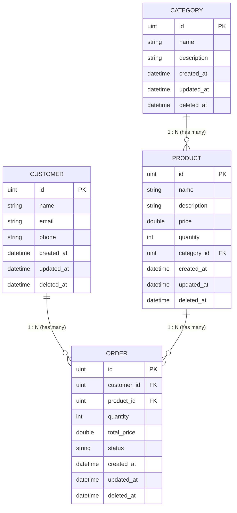

# 🛒 Store Management System (Go + GORM + MySQL)

[](https://golang.org)
[](https://gorm.io)
[](https://www.mysql.com)

โปรเจกต์ระบบจัดการร้านค้า (Store Management System) พัฒนาด้วยภาษา **Go** ร่วมกับ **GORM** และฐานข้อมูล **MySQL**  
สร้างขึ้นเพื่อเป็นแบบฝึกหัดในการเรียนรู้และประยุกต์ใช้งาน **ORM (Object-Relational Mapping)** อย่างครบถ้วน ตั้งแต่การออกแบบ Data Model, กำหนด Foreign Key ความสัมพันธ์ 1:N, การทำ Auto Migration, การทำ CRUD, ไปจนถึงการ Query เงื่อนไขซับซ้อนและการทำ Soft/Hard Delete

---

## 📌 สารบัญ (Table of Contents)
- [โครงสร้างความสัมพันธ์ของข้อมูล (ER Diagram)](#-โครงสร้างความสัมพันธ์ของข้อมูล-er-diagram)
- [โครงสร้างโฟลเดอร์ (Project Structure)](#-โครงสร้างโฟลเดอร์-project-structure)
- [ฟีเจอร์และการทำงาน (Features)](#-ฟีเจอร์และการทำงาน-features)
- [เทคโนโลยีและแพ็กเกจที่ใช้ (Tech Stack)](#-เทคโนโลยีและแพ็กเกจที่ใช้-tech-stack)
- [การติดตั้งและเริ่มต้นใช้งาน (Getting Started)](#-การติดตั้งและเริ่มต้นใช้งาน-getting-started)
- [สรุปเทคนิค GORM ที่ได้เรียนรู้จากโปรเจกต์นี้ (GORM Key Takeaways)](#-สรุปเทคนิค-gorm-ที่ได้เรียนรู้จากโปรเจกต์นี้-gorm-key-takeaways)

---

## 📊 โครงสร้างความสัมพันธ์ของข้อมูล (ER Diagram)

ระบบประกอบด้วย 4 ตารางหลัก โดยใช้ `gorm.Model` (มี `id`, `created_at`, `updated_at`, `deleted_at`) ในทุกตาราง:



### รายละเอียดความสัมพันธ์ (Relationships)
1. **Category 1 : N Product**: 1 หมวดหมู่มีสินค้าได้หลายชิ้น (`CategoryID`)
2. **Customer 1 : N Order**: 1 ลูกค้าสามารถสั่งซื้อได้หลายคำสั่งซื้อ (`CustomerID`)
3. **Product 1 : N Order**: 1 สินค้าสามารถถูกสั่งซื้อในหลายออเดอร์ โดย 1 คำสั่งซื้อผูกกับ 1 สินค้า (`ProductID`)

---

## 📁 โครงสร้างโฟลเดอร์ (Project Structure)

โปรเจกต์จัดโครงสร้างแบบ Single Package (`package main`) เพื่อให้เข้าใจการทำงานร่วมกันของไฟล์ต่างๆ ใน Go ได้ง่าย:

```text
go-gorm-01/
├── go.mod          # ไฟล์กำหนด Module และ Dependencies
├── go.sum          # Checksum ของ Dependencies
├── main.go         # Entry point, ตั้งค่า DB Connection, Auto Migration และเรียกใช้งานฟังก์ชัน
├── models.go       # Struct โมเดลทั้ง 4 ตาราง พร้อมกำหนด Foreign Key Association
├── category.go     # ฟังก์ชันจัดการข้อมูลหมวดหมู่ (Category CRUD)
├── product.go      # ฟังก์ชันจัดการสินค้า (ค้นหาตามช่วงราคา, สต็อก, Soft/Hard Delete)
├── customer.go     # ฟังก์ชันจัดการลูกค้า (Customer CRUD, ค้นหาด้วย Email)
└── order.go        # ฟังก์ชันจัดการคำสั่งซื้อ (Order CRUD, Filter วันที่/สถานะ, Multi-Table JOIN)
```

---

## 🚀 ฟีเจอร์และการทำงาน (Features)

### 1. หมวดหมู่สินค้า (`category.go`)
- `CreateCategoryDB`: เพิ่มหมวดหมู่สินค้าใหม่
- `deleteCategoryByIDDB`: ลบหมวดหมู่ โดยมีระบบตรวจสอบความปลอดภัย **ไม่อนุญาตให้ลบหากยังมีสินค้าอยู่ในหมวดหมู่นั้น**

### 2. สินค้า (`product.go`)
- **การสร้างและค้นหาข้อมูล (Read & Query):**
  - `getAllProductsDB`: แสดงรายการสินค้าทั้งหมด
  - `getProductByIDDB`: ค้นหาสินค้าจาก Primary Key
  - `getProductByNameDB`: ค้นหาสินค้าจากชื่อบางส่วนด้วย `LIKE %name%`
  - `getProductsByCategoryDB`: ค้นหาสินค้าตาม Category ID
  - `getProductsByPriceRangeDB`: ค้นหาสินค้าตามช่วงราคา (`BETWEEN min AND max`)
  - `getProductsLowStockDB`: แจ้งเตือนสินค้าที่สต็อกต่ำกว่าจำนวนที่ระบุ
  - `getProductsByCategoryAndPriceDB`: ค้นหาแบบหลายเงื่อนไข (ตามหมวดหมู่และช่วงราคาพร้อมกัน)
  - `getProductsSortedByPriceDB`: เรียงลำดับสินค้าตามราคา (`ASC` / `DESC`)
  - `getTopExpensiveProductsDB`: ค้นหาสินค้าที่แพงที่สุด N อันดับแรก (`LIMIT`)
- **การอัปเดตข้อมูล (Update):**
  - `updateProductByIDDB`: อัปเดตข้อมูลสินค้า พร้อมตรวจสอบราคาและสต็อกห้ามติดลบ
  - `updateProductPriceDB`: อัปเดตราคาเฉพาะฟิลด์
  - `updateProductStockDB`: เพิ่มหรือลดสต็อกสินค้าอย่างปลอดภัย
- **การลบและการกู้คืนข้อมูล (Delete & Restore):**
  - `softDeleteProductDB`: ลบข้อมูลแบบชั่วคราว (Soft Delete)
  - `hardDeleteProductDB`: ลบข้อมูลถาวรออกจากฐานข้อมูล (`Unscoped`) โดยเช็คประวัติการสั่งซื้อก่อนลบ
  - `getDeletedProductsDB`: ดึงรายการสินค้าทั้งหมดที่ถูก Soft Delete
  - `restoreProductDB`: กู้คืนสินค้าที่ถูก Soft Delete ให้กลับมาใช้งานได้

### 3. ลูกค้า (`customer.go`)
- `CreateCustomerDB`: บันทึกข้อมูลลูกค้าใหม่
- `getCustomerByEmailDB`: ค้นหาลูกค้าด้วยอีเมล
- `updateCustomerByIDDB`: อัปเดตข้อมูลส่วนตัวของลูกค้า
- `deleteCustomerByIDDB`: ลบข้อมูลลูกค้า (ป้องกันการลบหากลูกค้ามีประวัติการสั่งซื้อ)

### 4. คำสั่งซื้อ (`order.go`)
- `CreateOrderDB`: สร้างคำสั่งซื้อใหม่
- `getOrdersByCustomerDB`: ดูประวัติคำสั่งซื้อทั้งหมดของลูกค้ารายบุคคล
- `getOrdersByStatusDB`: กรองคำสั่งซื้อตามสถานะ (เช่น `Pending`, `Completed`, `Cancelled`)
- `getOrdersByDateRangeDB`: ค้นหาคำสั่งซื้อตามช่วงวันที่ (`BETWEEN start AND end`)
- `getOrdersWithDetailsDB`: ค้นหาคำสั่งซื้อพร้อมดึงรายละเอียดชื่อลูกค้าและชื่อสินค้าด้วยการ `JOIN` ตาราง
- `updateOrderStatusDB`: เปลี่ยนสถานะคำสั่งซื้อ พร้อมตรวจสอบความถูกต้องของสถานะ

---

## 🛠 เทคโนโลยีและแพ็กเกจที่ใช้ (Tech Stack)

- **Language:** Go (Golang)
- **Database Driver:** `gorm.io/driver/mysql`
- **ORM:** `gorm.io/gorm`
- **Database Server:** MySQL 8.x / MariaDB (XAMPP Compatible)

---

## 💻 การติดตั้งและเริ่มต้นใช้งาน (Getting Started)

### 1. ความต้องการของระบบ (Prerequisites)
- ติดตั้ง [Go](https://go.dev/dl/) (เวอร์ชัน 1.20 ขึ้นไป)
- ติดตั้ง MySQL หรือ XAMPP

### 2. สร้างฐานข้อมูล
เปิด MySQL แล้วสร้างฐานข้อมูลว่างชื่อ `store_db`:
```sql
CREATE DATABASE store_db CHARACTER SET utf8mb4 COLLATE utf8mb4_unicode_ci;
```

### 3. Clone โปรเจกต์ และติดตั้ง Dependencies
```powershell
git clone https://github.com/bannaruj/go-gorm-01.git
cd go-gorm-01
go mod tidy
```

### 4. กำหนดค่าการเชื่อมต่อฐานข้อมูล
ตรวจสอบค่าการเชื่อมต่อใน [main.go](file:///c:/Works/coding/go-gorm-01/main.go):
```go
const (
    host     = "localhost"
    port     = "3306"
    user     = "root"
    password = ""
    dbname   = "store_db"
)
```

### 5. สั่งรันโปรเจกต์
รันทุกไฟล์ในโฟลเดอร์พร้อมกันด้วยคำสั่ง:
```powershell
go run .
```
> เมื่อรันคำสั่งนี้ GORM จะทำ `AutoMigrate` สร้างตาราง `categories`, `products`, `customers`, และ `orders` พร้อมทั้งผูก Foreign Key ในฐานข้อมูลให้อัตโนมัติ

---

## 💡 สรุปเทคนิค GORM ที่ได้เรียนรู้จากโปรเจกต์นี้ (GORM Key Takeaways)

| หัวข้อ | การนำไปใช้งานในโค้ด | คำสั่ง GORM ตัวอย่าง |
| :--- | :--- | :--- |
| **Model Embedding** | สืบทอด ID, CreatedAt, UpdatedAt, DeletedAt | `gorm.Model` |
| **Foreign Key 1:N** | เชื่อมโยงความสัมพันธ์ระหว่างตาราง | `CategoryID uint`<br>`Category Category `gorm:"foreignKey:CategoryID"`` |
| **Auto Migration** | สร้างและอัปเดต Schema ตารางอัตโนมัติ | `db.AutoMigrate(&Category{}, &Product{}, ...)` |
| **Condition Query** | การค้นหาข้อมูลตามเงื่อนไข | `db.Where("price BETWEEN ? AND ?", min, max).Find(&products)` |
| **Pattern Matching** | ค้นหาข้อความบางส่วน | `db.Where("name LIKE ?", "%"+name+"%").Find(&products)` |
| **Sorting & Limit** | เรียงลำดับและจำกัดจำนวนผลลัพธ์ | `db.Order("price DESC").Limit(limit).Find(&products)` |
| **Soft Delete** | ลบแบบซ่อน (บันทึกเวลาลง `deleted_at`) | `db.Delete(&product)` |
| **Unscoped** | ค้นหาหรือลบถาวรรวมถึงรายการที่ถูก Soft Delete | `db.Unscoped().Where("deleted_at IS NOT NULL")`<br>`db.Unscoped().Delete(&product)` |
| **Joins Query** | เชื่อมตารางเพื่อดึงข้อมูลแบบละเอียด | `db.Table("orders").Joins("JOIN customers ON ...")` |

---

## 📄 License
This project is open-source and free to use for educational purposes.
